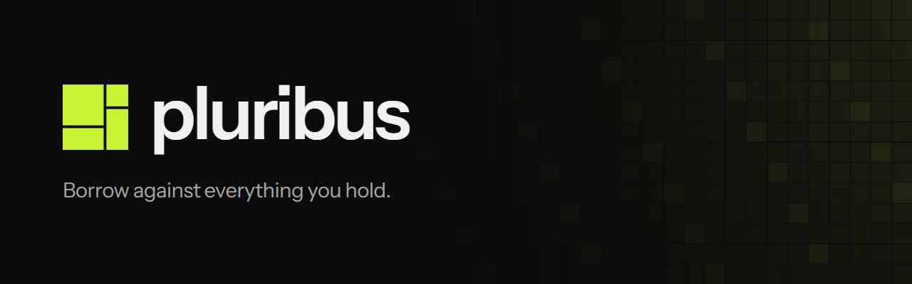
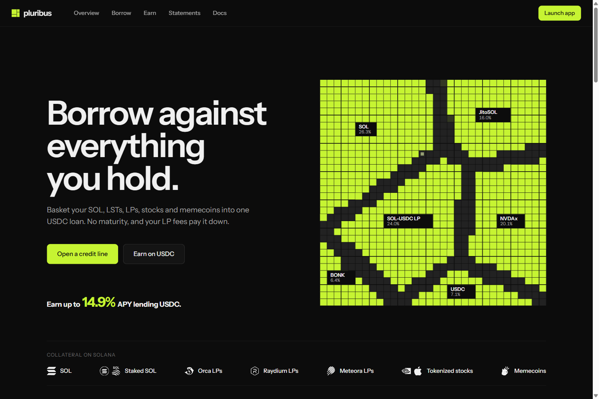
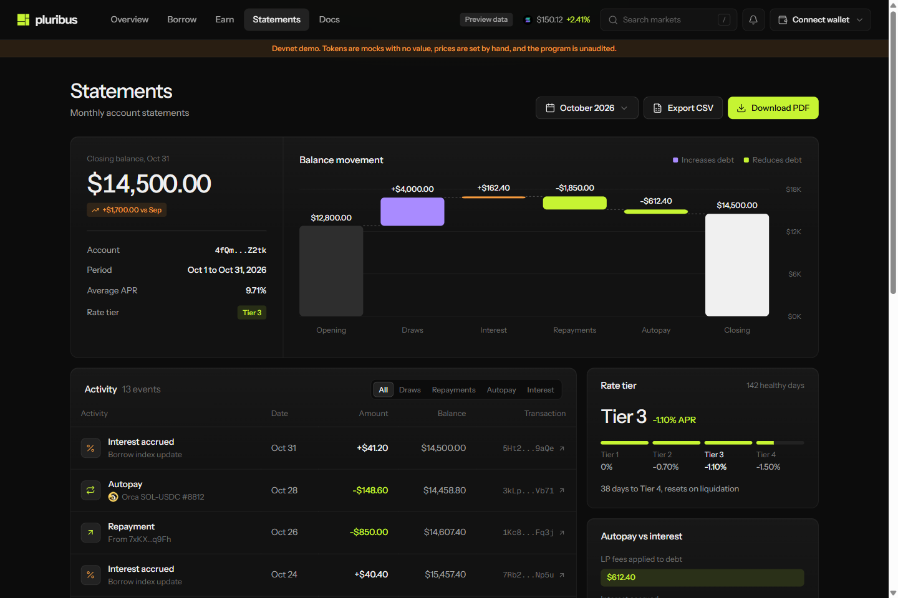
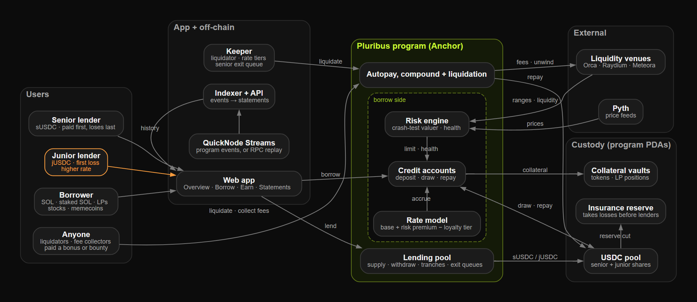

<p align="center">
  <a href="https://www.pluribus.finance">
    
  </a>
</p>

<p align="center">
  <a href="https://www.pluribus.finance"><b>Live demo</b></a>
  &nbsp;·&nbsp;
  <a href="docs/users.md">User guide</a>
  &nbsp;·&nbsp;
  <a href="docs/liquidators.md">Liquidator guide</a>
  &nbsp;·&nbsp;
  <a href="doc_and_refs/TUNES.md">Every setting</a>
</p>

<p align="center">
  
  
  
  
  
</p>

# Pluribus

Pluribus is a Solana lending protocol that gives you **one USDC credit line against everything you hold**: SOL, staked SOL, tokenized stocks, a memecoin and Orca, Raydium and Meteora liquidity positions, in one account. There is no maturity, and your liquidity positions' trading fees pay the loan down.

Lenders supply the USDC through a senior or a junior tranche.

> [!WARNING]
> Pluribus is an unaudited hackathon project. It runs on Solana devnet and on the hosted demo's own test chain, both with mock tokens. On each, one key is both the admin and the upgrade authority. Do not use it with real money.

<p align="center">
  
</p>

## What makes it different

**One basket, one loan.** The program values the whole account under each of three crash scenarios and takes the worst total. A mixed account borrows more than the same assets held apart: $5,000 of SOL plus $5,000 of a tokenized stock supports $6,937.50, against $6,250 in two accounts.

**Liquidity positions count as collateral.** An Orca, Raydium or Meteora SOL/USDC position is revalued from its range at each crash price, using only the oracle price.

**LP fees pay down the loan.** Anyone can collect a deposited position's fees for a small bounty. The USDC repays your debt, and the rest stays as collateral. A position can compound instead.

**Lenders choose their risk.** Seniors are paid first and lose last. Juniors take losses first and earn a multiple of the senior rate.

## The app

| | |
|---|---|
| **Overview.** Supply, borrowing, volume, fees and every collateral market. | **Borrow.** Deposit collateral, see your limit and health, draw or repay. |
|  |  |
| **Earn.** Lend into either tranche and follow yield, utilization and deposits. | **Statements.** Monthly draws, repayments, autopay and interest, with CSV and PDF export. |
|  |  |

The screenshots show sample data from an earlier build. The app now shows the chain's own figures.

## How it works

[docs/users.md](docs/users.md) has the full rules and [doc_and_refs/TUNES.md](doc_and_refs/TUNES.md) every setting.

### Collateral

A credit account holds up to 16 positions.

| Collateral | Priced by |
|---|---|
| SOL, NVDAx, AAPLx, BONK | admin-set prices on devnet |
| JitoSOL, JupSOL | live Pyth feeds on devnet |
| USDC | fixed at $1 |
| Orca, Raydium (SDK only) and Meteora SOL/USDC positions | their range or bins at the oracle price |

On the hosted demo, the price feed copies real mainnet prices onto the chain every 10 seconds.

### Credit limit

Under each crash scenario, each position is priced at the low end of the oracle's band, cut by the scenario's shock and by the asset's liquidation cost, and the positions are added up. The lowest total is the credit limit. Shocks rise with an asset's recent volatility.

What $10,000 of collateral supports on devnet:

| Collateral | Credit limit | Liquidation limit |
|---|---|---|
| USDC | $9,700 | $9,900 |
| SOL | $6,650 | $7,600 |
| JitoSOL or JupSOL | $6,110 | $7,238 |
| NVDAx or AAPLx | $5,850 | $6,750 |
| BONK | $3,400 | $4,675 |
| $5,000 SOL + $5,000 NVDAx | $6,937.50 | $7,650 |

### Interest

- The rate follows utilization: 2% idle, 10% at the 90% kink, 70% fully lent. It accrues every second.
- Healthy accounts move to cheaper tiers after 7 and 30 days.
- Risky collateral adds a premium, paid to junior lenders: 15% a year for BONK and 3% for the stocks, weighted by their share of your borrowing power.

### Liquidation

Once debt passes the liquidation limit (the credit limit with smaller shocks), a liquidator repays up to half the debt per transaction and takes that much collateral plus a bonus of up to 5%. The program picks which position goes first. See [docs/liquidators.md](docs/liquidators.md).

### Lending

| | Senior | Junior |
|---|---|---|
| Takes losses | last | first |
| Rate | the senior rate | a multiple of it that grows as juniors get scarcer |
| Exit | at once from idle USDC, otherwise a queue | an exit queue (6 days on devnet), then a claim window |

Losses come out of unpaid interest, then the insurance reserve, uncollected protocol fees, juniors and finally seniors.

## Architecture

<p align="center">
  
</p>

- **Program.** One Anchor program: the risk engine, the rate model, custody of collateral and the two-tranche USDC pool. It calls into Orca, Raydium and Meteora to hold positions, read them, collect their fees and unwind them.
- **SDK.** Builds every instruction and mirrors the program's maths. The app, keeper and scripts all use it.
- **Keeper.** Liquidates, refreshes tiers and premiums, pays the senior withdrawal queue and keeps price feeds fresh. Anyone collects LP fees, not the keeper.
- **Price feed.** Copies mainnet prices onto a local chain such as the hosted demo's.
- **Indexer.** Stores the program's events from QuickNode Streams or plain RPC, for the Statements and Overview pages.

The figure's source is `docs/diagrams/architecture.dot`.

## Repository

| Path | Contents |
|---|---|
| `programs/pluribus` | The program and its tests |
| `sdk` | The TypeScript SDK and IDL |
| `web` | The Next.js app, landing page and docs |
| `keeper` | The reference keeper and liquidator |
| `pricefeed` | Mirrors mainnet prices onto a local chain |
| `indexer` | The event store |
| `scripts` | Local chain, setup, faucet, prices and tests |
| `deployments` | Each deployment's addresses |
| `deploy/macmini` | Services for the hosted demo's chain |
| `docs` | The user and liquidator guides, also served by the app |
| `doc_and_refs` | Every setting, and the Meteora DLMM design notes |

## Run it locally

On Linux, macOS or WSL, with Rust 1.89.0, Solana CLI 4.1.2, Anchor 1.2.2 and Node 22. The scripts sign with `~/.config/solana/id.json`.

```sh
npm install
anchor build --ignore-keys
npm run localnet   # keep it running
npm run dev        # in a second terminal, then open http://localhost:3000
```

Connect a wallet ("Demo wallet" needs no extension), press **Get test tokens** in the wallet menu, deposit and draw.

Without a local chain, `npm run dev` uses the hosted demo's chain, so only Node is needed. Optional variables go in `web/.env.local`:

| Variable | Purpose |
|---|---|
| `NEXT_PUBLIC_LOCAL` | `1` uses the local chain. `npm run localnet` sets it while running |
| `NEXT_PUBLIC_CLUSTER` | `devnet` uses devnet |
| `NEXT_PUBLIC_RPC_URL`, `NEXT_PUBLIC_WS_URL` | Override the deployment's RPC and websocket URLs |
| `NEXT_PUBLIC_INDEXER_URL` | The indexer, for statements and history |
| `NEXT_PUBLIC_DEMO_WALLET` | `0` hides the demo wallet |
| `FAUCET_SECRET` | Server only. Turns on **Get test tokens**, and on a local chain the 1-second harvest test |
| `DEMO_ADMIN_SECRET` | Server only. Turns on the demo price control |

## Commands

From the repository root:

| Command | What it does |
|---|---|
| `npm run dev` | The web app |
| `npm run localnet` | A local validator with Orca, Meteora and Pluribus, set up and kept running |
| `npm run setup` | Sets the protocol up on a cluster, safe to rerun |
| `npm run faucet -- --to <address>` | Sends test SOL, stock, USDC and an Orca position |
| `npm run price -- --asset sol --price <usd>` | Sets a demo price |
| `npm run pricefeed` | Copies mainnet prices onto a local chain |
| `npm run keeper` | The keeper. `DRY_RUN=1` sends nothing |
| `npm run indexer`, `npm run indexer:replay` | The event store, and a feed for it from plain RPC |
| `npm run e2e` | End-to-end checks on a local validator |
| `npm run smoke` | A smoke test for a live cluster, safe to rerun |
| `npm run idl`, `npm run sdk:sync` | Copy the IDL into the SDK, and the SDK and deployments into the app |

## Tests

The program has 261 tests: 249 in 16 files, run in-process with LiteSVM, some against copies of the Orca, Raydium and Meteora programs, and 12 unit tests.

```sh
cargo test
```

`npm run orca:snapshot`, `npm run raydium:snapshot` and `npm run dlmm:snapshot` download the dex binaries into `programs/pluribus/tests/fixtures`. For the app, run `npm run lint` and `npm run build` in `web`.

## Deployments

| | |
|---|---|
| Program | [`A4UnuBwwBLbvxj3AnUtCDzkj11kp1wdPh8CydUn5quc7`](https://explorer.solana.com/address/A4UnuBwwBLbvxj3AnUtCDzkj11kp1wdPh8CydUn5quc7?cluster=devnet), on devnet and the hosted demo's chain |
| Listed assets | USDC, SOL, NVDAx, AAPLx, JitoSOL, JupSOL, BONK |
| Devnet addresses | `deployments/devnet.json` |
| Hosted demo | https://www.pluribus.finance, addresses in `deployments/macmini.json` |

The hosted demo runs on its own test chain with real mainnet prices and waits cut to seconds, see [The hosted demo](docs/users.md#the-hosted-demo). Its faucet works and its price controls are off.

## Documentation

- [Using Pluribus](docs/users.md): borrowing, lending and the numbers in force.
- [Liquidating on Pluribus](docs/liquidators.md): the instructions, the ordering rule and the reference keeper.
- [Tunes](doc_and_refs/TUNES.md): every setting and its allowed range. It wins where another page disagrees.
- [Meteora DLMM positions as collateral](doc_and_refs/DLMM.md): custody, valuation and liquidation of DLMM positions.
