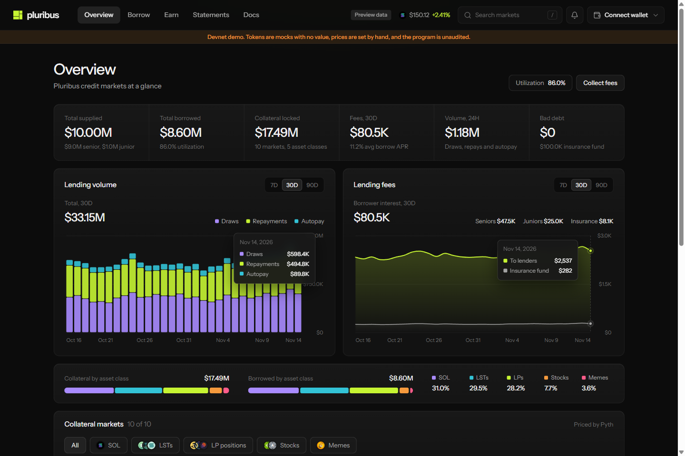
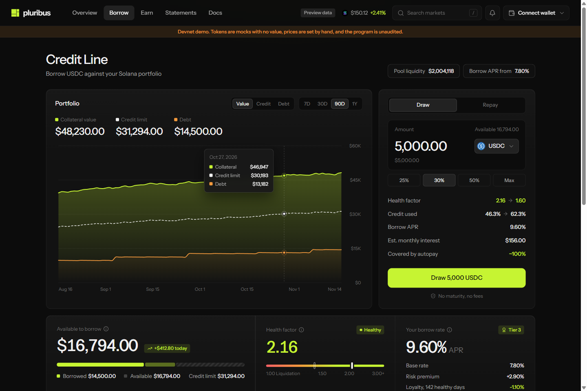
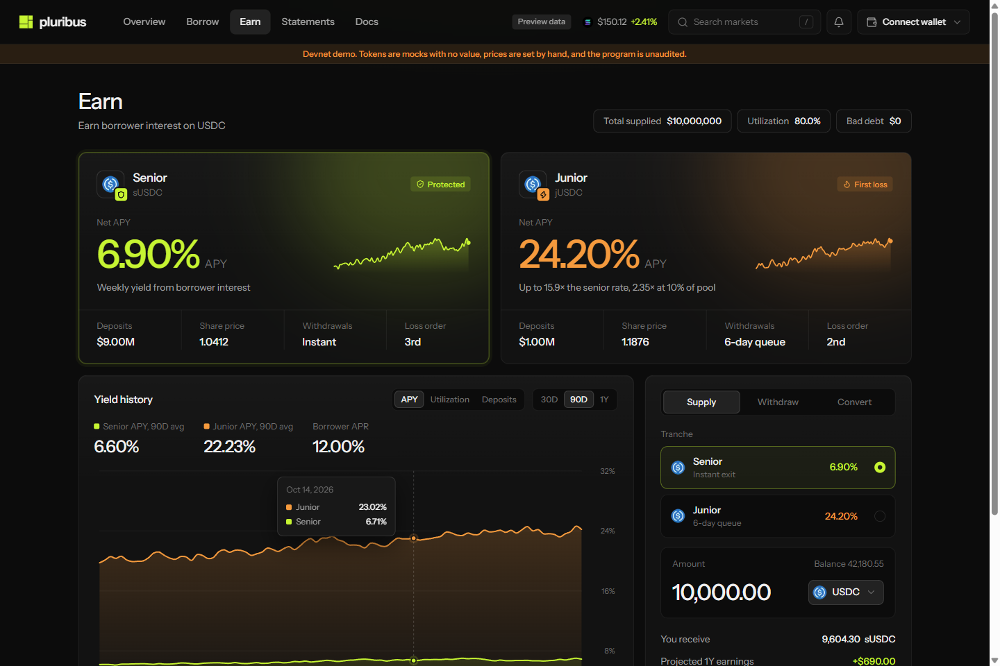

<p align="center">
  <a href="https://pluribus-dun.vercel.app">
    
  </a>
</p>

<p align="center">
  <a href="https://pluribus-dun.vercel.app"><b>Live demo</b></a>
  &nbsp;·&nbsp;
  <a href="docs/users.md">User guide</a>
  &nbsp;·&nbsp;
  <a href="docs/liquidators.md">Liquidator guide</a>
  &nbsp;·&nbsp;
  <a href="doc_and_refs/TUNES.md">Every setting</a>
</p>

<p align="center">
  
  
  
  
  
</p>

# Pluribus

Pluribus is a lending protocol on Solana that gives you **one USDC credit line against everything you hold**. A single account can hold SOL, staked SOL, tokenized stocks, a memecoin and concentrated-liquidity positions from Orca, Raydium and Meteora, and you borrow against all of it together. There is no maturity and no repayment schedule, and the trading fees your liquidity positions earn pay the loan down.

Lenders supply the USDC through a senior or a junior tranche, and choose how much risk they take for their rate.

> [!WARNING]
> Pluribus is a hackathon project. The only deployment is on Solana **devnet**, its tokens are mocks with no value, most of its prices are set by an admin key for the demo, and the program has **not been audited**. One key is both the admin and the upgrade authority. Do not use it with real money.

<p align="center">
  
</p>

## Contents

- [What makes it different](#what-makes-it-different)
- [The app](#the-app)
- [How it works](#how-it-works)
- [Architecture](#architecture)
- [What is in this repository](#what-is-in-this-repository)
- [Run it locally](#run-it-locally)
- [Commands](#commands)
- [Tests](#tests)
- [Devnet deployment](#devnet-deployment)
- [Documentation](#documentation)

## What makes it different

**One basket, one loan.** Most lending markets size a loan asset by asset. Pluribus values the whole account under each of three crash scenarios and takes the worst total. Because the totals are added before the worst one is picked, a mixed account borrows more than the same assets held apart: $5,000 of SOL with $5,000 of a tokenized stock supports $6,937.50, against $6,250 in two separate accounts.

**Liquidity positions count as collateral.** An Orca, Raydium or Meteora SOL/USDC position is revalued from its own range and liquidity at each crash price. Only the oracle price is used, never the pool's own, so trading in the pool cannot move what the position is worth to the loan.

**Your LP fees pay down the loan.** Anyone can collect the trading fees of a deposited position for a small bounty. The USDC repays your debt, and the rest stays in the account as collateral. A position can compound its fees back into itself instead.

**Lenders choose their risk.** Senior lenders are paid first and lose money last. Junior lenders take losses first, and earn a multiple of the senior rate for covering them.

## The app

| | |
|---|---|
| **Overview.** The pool at a glance: what is supplied and borrowed, daily volume and fees, and every collateral market. | **Borrow.** Deposit collateral, see your credit limit and health, and draw or repay USDC. |
|  |  |
| **Earn.** Lend USDC into the senior or the junior tranche, and follow the yield, utilization and deposits over time. | **Statements.** A monthly statement of draws, repayments, autopay and interest, with CSV and PDF export. |
|  |  |

The screenshots show the app's preview data, which is what it displays before a wallet is connected.

## How it works

The short version is below. [docs/users.md](docs/users.md) is the full account, and [doc_and_refs/TUNES.md](doc_and_refs/TUNES.md) lists every setting with its allowed range.

### Collateral

A credit account holds up to 5 positions.

| Collateral | Priced by |
|---|---|
| SOL | demo price on devnet |
| JitoSOL and JupSOL (mock staked SOL) | live Pyth feeds |
| NVDAx and AAPLx (mock tokenized stocks, AAPLx on Token-2022) | demo price on devnet |
| BONK (mock memecoin) | demo price on devnet |
| USDC | the unit everything else is priced in |
| Orca SOL/USDC position | its range and liquidity at the oracle price |
| Raydium SOL/USDC position (SDK only, not yet in the app) | its range and liquidity at the oracle price |
| Meteora DLMM SOL/USDC position | its bins at the oracle price |

### Credit limit

The program values the account under each crash scenario and keeps the lowest total:

1. Each position is priced at the low end of the oracle's confidence band.
2. The price is cut by the scenario's shock for that asset's group.
3. The value is cut again by the asset's liquidation cost.
4. The positions are added up, and the lowest total across the scenarios is the credit limit.

Each shock is the larger of a table value and one worked out from the asset's recent volatility, so the limit tightens in a volatile market.

What $10,000 of collateral supports on devnet:

| Collateral | Credit limit | Liquidation limit |
|---|---|---|
| USDC | $9,700 | $9,900 |
| SOL | $6,650 | $7,600 |
| JitoSOL or JupSOL | $6,110 | $7,238 |
| NVDAx or AAPLx | $5,850 | $6,750 |
| BONK | $3,400 | $4,675 |
| $5,000 SOL + $5,000 NVDAx | $6,937.50 | $7,650 |

### Interest

- The rate follows pool utilization: 2% when the pool is idle, 10% at the 90% kink and 70% when it is fully lent.
- It is variable and accrues every second.
- An account that stays healthy moves to a cheaper tier, after 7 and then 30 days.
- Risky collateral adds a risk premium (15% a year for BONK, 3% for the stocks on devnet), weighted by how much of your borrowing power it provides. The premium is paid to junior lenders.

### Liquidation

An account can be liquidated when its debt is above its liquidation limit, which is worked out like the credit limit with smaller shocks. A liquidator repays up to half the debt per transaction and takes collateral worth that amount plus a bonus of up to 5%. The program, not the liquidator, picks which position goes first. [docs/liquidators.md](docs/liquidators.md) covers the instructions, the ordering rule and a worked example.

### Lending

| | Senior | Junior |
|---|---|---|
| Takes losses | last | first |
| Rate | the senior rate | the senior rate times a multiple that grows as juniors get scarcer |
| Exit | at once from idle USDC, otherwise a withdrawal queue | a 6-day exit queue, then a 2-day claim window |

A loss is booked when a borrower's account has debt and no collateral left. It is taken, in order, from unpaid interest, the insurance reserve, uncollected protocol fees, junior lenders and finally senior lenders.

## Architecture

<p align="center">
  
</p>

- **Users.** Borrowers and lenders act through the web app. Anyone can also liquidate an account past its limit, or collect a position's fees, and is paid a bonus or a bounty for it.
- **Program.** One Anchor program holds everything on chain. The risk engine values every position under the crash scenarios and sets each account's limit and health. The rate model accrues interest from pool utilization, the risk premium and the loyalty tier. The lending pool runs both tranches and their exit queues.
- **Custody.** Collateral sits in vaults the program owns, and lenders' USDC in one pool with senior and junior shares. A cut of borrower interest builds the insurance reserve, which takes losses before any lender does.
- **External.** The program calls into Orca, Raydium and Meteora to hold positions, read their ranges and liquidity, collect their fees and unwind them in a liquidation. Prices come from Pyth.
- **SDK.** Builds every instruction and mirrors the program's maths, so the app can show a limit or a health figure before anything is sent. The web app, the keeper and the scripts all go through it.
- **Keeper.** One loop that liquidates, refreshes rate tiers and risk premiums, pays the head of the senior withdrawal queue and keeps the demo price feeds fresh. It does not collect LP fees: anyone can, for the bounty.
- **Indexer.** Stores the program's events, pushed by QuickNode Streams or replayed from plain RPC, and serves the history behind the Statements and Earn pages.

The figure's source is `docs/diagrams/architecture.dot`.

## What is in this repository

| Path | What it holds |
|---|---|
| `programs/pluribus` | The on-chain program and its test suite |
| `sdk` | The TypeScript SDK and the generated IDL |
| `web` | The Next.js app: landing page, app pages and docs |
| `keeper` | The reference keeper and liquidator |
| `indexer` | The event store behind statements and lending history |
| `scripts` | Local chain boot, protocol setup, faucet, demo price control, end-to-end and smoke tests |
| `deployments` | Addresses of each deployment, read by the SDK, the scripts and the app |
| `docs` | The user and liquidator guides, also rendered inside the app |
| `doc_and_refs` | Every tunable setting, and the design notes for Meteora DLMM collateral |

## Run it locally

You need Linux, macOS or WSL. The project is tested with Rust 1.89.0, Solana CLI 4.1.2, Anchor 1.2.2 and Node 22. The scripts sign with the keypair at `~/.config/solana/id.json`.

```sh
npm install
anchor build --ignore-keys
npm run localnet   # keep it running; the first run downloads the Orca program from devnet
npm run dev        # in a second terminal, then open http://localhost:3000
```

Then, in the app:

1. Open **Borrow** and connect a wallet. "Demo wallet" needs no browser extension.
2. Press **Get test tokens** in the wallet menu. It sends SOL, USDC, the mock stocks, staked SOL, BONK and one Orca position.
3. Deposit collateral, then draw USDC.
4. Open **Earn** to lend into either tranche.

### Just the web app

With no local chain running, `npm run dev` points the app at the devnet deployment, so the front end runs with nothing else installed but Node. **Get test tokens** only appears when the server holds the faucet key.

The app reads these optional variables from `web/.env.local`. `web/.env.example` lists them.

| Variable | Purpose |
|---|---|
| `NEXT_PUBLIC_CLUSTER` | `localnet` to use the local chain; devnet otherwise. `npm run localnet` sets this by itself |
| `NEXT_PUBLIC_RPC_URL` | Overrides the RPC URL from the deployment file. Worth setting: the public devnet RPC rate-limits quickly |
| `NEXT_PUBLIC_DEMO_WALLET` | `0` hides the browser-stored demo wallet |
| `NEXT_PUBLIC_INDEXER_URL` | Base URL of the indexer, for statements and lending history |
| `FAUCET_SECRET` | Server only. The faucet keypair, which turns on **Get test tokens** |
| `DEMO_ADMIN_SECRET` | Server only. The pool admin keypair, which turns on the demo price control |

## Commands

Run from the repository root.

| Command | What it does |
|---|---|
| `npm run dev` | Starts the web app |
| `npm run localnet` | Boots a local validator with Orca and Pluribus loaded, sets the protocol up and keeps running |
| `npm run setup` | Sets the protocol up on a cluster; safe to rerun |
| `npm run faucet -- --to <address>` | Sends a wallet test SOL, stock, mock USDC and an Orca position |
| `npm run price -- --asset sol --price <usd>` | Moves a demo price, which is how the demo crashes a market |
| `npm run keeper` | Runs the keeper. `DRY_RUN=1` logs each action and sends nothing |
| `npm run indexer` | Runs the event store |
| `npm run indexer:replay` | Feeds the indexer from plain RPC, so it works without QuickNode Streams |
| `npm run e2e` | End-to-end checks against a local validator with the real Orca program |
| `npm run smoke` | A smoke test for a live cluster; it ends with no debt and is safe to rerun |
| `npm run idl` | Copies the built IDL into the SDK |
| `npm run sdk:sync` | Copies the SDK and deployment files into the web app |

## Tests

The program has 246 tests across 16 files, run in-process with LiteSVM. They cover borrowing and lending flows, liquidation and its ordering, both tranches and their exit queues, the risk premium, volatility-driven shocks, Token-2022 stocks, staked SOL, and Orca, Raydium and Meteora positions against copies of the real programs.

```sh
cargo test
```

The Orca, Raydium and Meteora program binaries are too large to commit. `npm run orca:snapshot`, `npm run raydium:snapshot` and `npm run dlmm:snapshot` download them into `programs/pluribus/tests/fixtures`.

For the web app, from `web`:

```sh
npm run lint
npm run build
```

## Devnet deployment

| | |
|---|---|
| Program | [`A4UnuBwwBLbvxj3AnUtCDzkj11kp1wdPh8CydUn5quc7`](https://explorer.solana.com/address/A4UnuBwwBLbvxj3AnUtCDzkj11kp1wdPh8CydUn5quc7?cluster=devnet) |
| Listed assets | USDC, SOL, NVDAx, AAPLx, JitoSOL, JupSOL, BONK |
| Addresses | `deployments/devnet.json` |
| Hosted app | https://pluribus-dun.vercel.app |

The hosted app runs against this deployment. Its faucet and demo price controls are switched off.

## Documentation

- [Using Pluribus](docs/users.md): borrowing, lending, every rule and the numbers in force on devnet.
- [Liquidating on Pluribus](docs/liquidators.md): when an account can be liquidated, the instructions, the ordering rule and the reference keeper.
- [Tunes](doc_and_refs/TUNES.md): every setting, where it lives and its allowed range. Where it and another page disagree, it is right.
- [Meteora DLMM positions as collateral](doc_and_refs/DLMM.md): custody, valuation and liquidation of DLMM positions.
